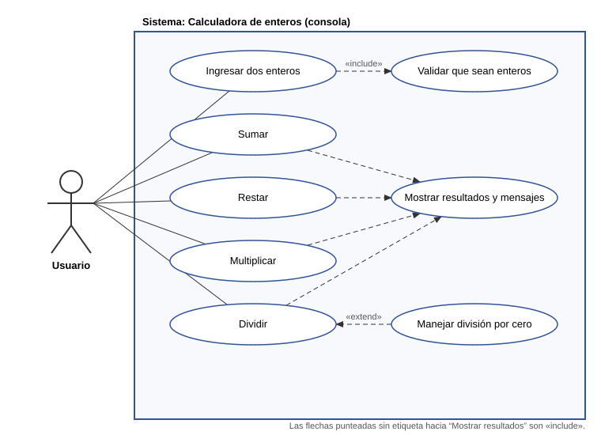

# Calculadora de enteros en consola — Informe del proyecto (v1.1)

## 1–4. Aplicación

Código en `src/main/java/co/estadistica/calculadora/`:

| Archivo | Responsabilidad |
|---|---|
| `Calculadora.java` | Un método por operación: `suma`, `resta`, `multiplicacion`, `division` y, desde v1.1, `potencia` (ver punto 10). |
| `Main.java` | Lectura de los dos enteros por consola, validación y escritura de resultados/errores. |

Decisiones de diseño:

- **Solo enteros**: la entrada se lee como texto y se convierte con `Integer.parseInt`. Si no es un entero válido (letras, decimales como `3.5`, vacío, fuera del rango de `int`) se muestra un mensaje de error y **se vuelve a pedir el dato**.
- **Sin desbordamiento**: `suma`, `resta` y `multiplicacion` devuelven `long`, así que dos `int` nunca desbordan.
- **División**: devuelve `double` (`5 / 2 = 2.5`). Si `b == 0` lanza `ArithmeticException("Error: no se puede dividir entre cero.")`, que `Main` captura e imprime; las otras tres operaciones se siguen mostrando.

Ejecución:

```bash
mvn compile
java -cp target/classes co.estadistica.calculadora.Main
```

Ejemplo (`7` y `0`):

```
Ingrese el valor de a: 7
Ingrese el valor de b: 0
a + b = 7
a - b = 7
a * b = 0
a / b -> Error: no se puede dividir entre cero.
```

## 5. Diagrama UML de casos de uso



(Fuente PlantUML en [`casos_de_uso.puml`](casos_de_uso.puml).)

**Actores**

| Actor | Tipo | Descripción |
|---|---|---|
| Usuario | Primario | Persona que ejecuta la aplicación, escribe los dos enteros y lee los resultados en consola. |

El *cliente* que aprueba los requisitos es un interesado (stakeholder), no un actor del sistema: no interactúa con la aplicación en ejecución.

**Casos de uso**

| ID | Caso de uso | Relación |
|---|---|---|
| UC1 | Ingresar dos enteros | Usuario → UC1; «include» UC8 |
| UC8 | Validar que sean enteros | Rechaza y vuelve a pedir el dato |
| UC2 | Sumar | Usuario → UC2; «include» UC6 |
| UC3 | Restar | Usuario → UC3; «include» UC6 |
| UC4 | Multiplicar | Usuario → UC4; «include» UC6 |
| UC5 | Dividir | Usuario → UC5; «include» UC6 |
| UC9 | Calcular potencia (a^b) *(v1.1)* | Usuario → UC9; «include» UC6 |
| UC7 | Manejar división por cero | «extend» de UC5 (solo si b = 0) |
| UC6 | Mostrar resultados y mensajes | Salida por consola |

## 6–7. Pruebas unitarias y hoja de Excel

La hoja de Excel de la asignación **no estaba en el repositorio**, así que se creó una con el formato habitual (ID, función, descripción, entradas, resultado esperado, resultado obtenido, estado): [`Pruebas_Calculadora.xlsx`](Pruebas_Calculadora.xlsx). Si tiene la suya, las columnas se pueden copiar tal cual.

- Los casos están implementados como tests JUnit 5 en `src/test/java/.../CalculadoraTest.java` con los mismos IDs (`TC-01` … ).
- La columna *Resultado obtenido* **no se escribió a mano**: `tools/generar_excel.py` ejecuta la aplicación real con las entradas de cada caso, captura su salida y la compara con el esperado.
- Para reproducir: `mvn test` y `mvn -q compile && python3 tools/generar_excel.py`.

Resultado de la última ejecución: **32 casos, 32 pasan, 0 fallan** (`mvn test`: 32 tests, 0 fallos). TC-01…TC-22 corresponden a v1.0 y TC-23…TC-32 a la potencia (v1.1).

Técnicas usadas: clases de equivalencia (positivos, negativos, cero) y valores límite (`Integer.MAX_VALUE`, división entre cero, entrada fuera de rango).

## 8. ISO/IEC 25010 — ¿qué dimensiones evaluar?

| Característica | ¿Vale la pena? | Justificación |
|---|---|---|
| **Adecuación funcional** (completitud, corrección, pertinencia) | **Sí — la principal** | Es el corazón: ¿calcula bien las 4 operaciones y maneja la división por cero? |
| **Fiabilidad** (madurez, tolerancia a fallos, recuperabilidad) | **Sí** | La app no debe caerse con entradas inválidas ni con división por cero; tolerancia a fallos es requisito explícito. |
| **Usabilidad** (reconocibilidad, operabilidad, protección contra errores de usuario, estética) | **Sí, de forma ligera** | Prompts claros, mensajes de error entendibles, protección ante entradas inválidas. |
| **Mantenibilidad** (modularidad, reusabilidad, analizabilidad, modificabilidad, capacidad de prueba) | **Sí** | Un método por operación y la lógica separada de la E/S lo hacen testeable; además el cliente pedirá un cambio (punto 10), lo que mide la modificabilidad. |
| **Eficiencia de desempeño** | **Solo un chequeo mínimo** | Las operaciones son O(1) (la potencia, O(b)); basta comprobar que una potencia con exponente grande no se queda "colgada". No justifica pruebas de carga. |
| **Compatibilidad** (coexistencia, interoperabilidad) | **No** | No comparte recursos ni se integra con otros sistemas. |
| **Seguridad** (confidencialidad, integridad, autenticidad…) | **No** (salvo la validación de entrada) | Sin datos sensibles, red, usuarios ni persistencia. |
| **Portabilidad** (adaptabilidad, instalabilidad, reemplazabilidad) | **No vale la pena evaluar a fondo** | Java corre en cualquier JVM; basta anotar la versión mínima (17). |

## 9. ¿Qué pruebas se harían para las dimensiones que sí se evalúan?

**Adecuación funcional**

- Pruebas unitarias de cada operación: positivos, negativos, cero, signos mezclados (TC-01…TC-15).
- Valores límite: `Integer.MAX_VALUE` / `MIN_VALUE` sin desbordamiento (TC-04, TC-11).
- División: exacta, con decimales, 0/n, n/0 y 0/0 con su mensaje (TC-12…TC-17).
- Prueba de aceptación de extremo a extremo: ejecutar `Main` con entradas reales y verificar la salida completa.

**Fiabilidad**

- Entradas inválidas: letras, decimales, vacío, símbolos, números fuera de rango, fin de entrada (Ctrl+D) → la app no lanza excepciones sin controlar (TC-19…TC-22).
- Tras una división entre cero, las otras tres operaciones siguen mostrándose.
- Ejecuciones repetidas con las mismas entradas dan el mismo resultado (madurez).

**Usabilidad**

- Revisión de los mensajes: ¿dicen qué pasó y qué se espera ("solo se aceptan enteros entre …")?
- Prueba con 2–3 personas ajenas al desarrollo: ¿entienden qué escribir sin explicación?
- Verificar que tras un error se vuelve a pedir el dato en lugar de terminar.

**Mantenibilidad**

- Revisión de código: un método por operación, sin E/S dentro de `Calculadora`.
- Cobertura de líneas/ramas de los tests (objetivo ≥ 90 % en `Calculadora`).
- Prueba de modificabilidad: medir cuánto cuesta añadir la quinta operación (ver punto 10).

**Eficiencia (chequeo mínimo)**

- Medir el tiempo de la operación más costosa (potencia con exponente grande) para confirmar que es despreciable.

## 10. Cambio de requisitos: quinta operación (potencia)

El cliente pide, con el proyecto ya aprobado y probado, la operación *a elevado a b* con un ciclo `for`. Es un **cambio de alcance**, así que no se programa directamente: se registra, se analiza su impacto, se aclaran los casos borde con el cliente, se obtiene su aprobación y solo entonces se implementa en una versión nueva (v1.1) con pruebas de regresión. El detalle completo está en [`Gestion_del_cambio.md`](Gestion_del_cambio.md).

Resumen de lo implementado:

```java
public long potencia(int a, int b) {
    if (b < 0) throw new ArithmeticException("Error: el exponente debe ser mayor o igual a cero.");
    long resultado = 1;
    for (int i = 0; i < b; i++) {
        resultado = Math.multiplyExact(resultado, (long) a); // error si no cabe en long
    }
    return resultado;
}
```

Supuestos pendientes de confirmación por el cliente: exponente negativo → error; 0^0 = 1; resultado que no cabe en `long` → mensaje de error.
